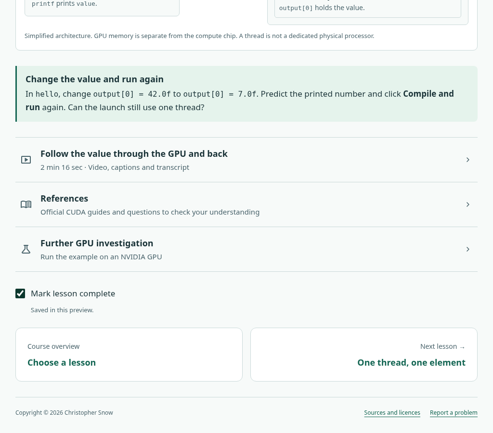
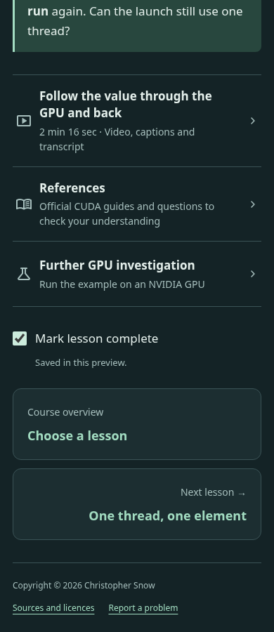
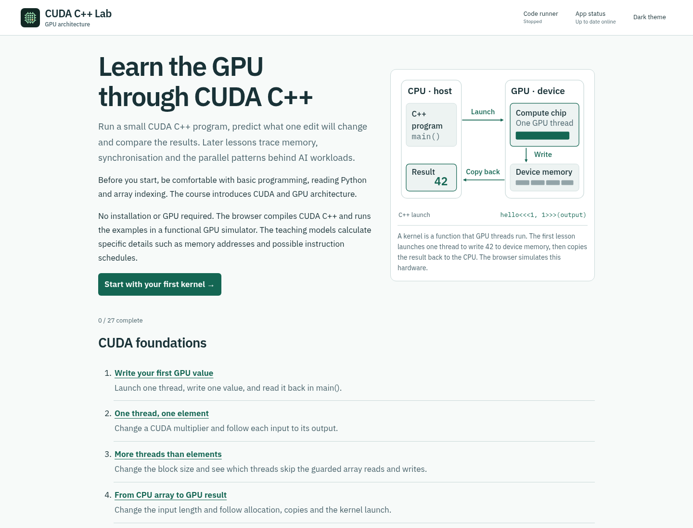

# Shared course design guide

Use one recognisable reading and interaction pattern across the labs: a compact
lesson opening, one clear experiment at a time, readable evidence, optional
resources, explicit completion and a clear next lesson. Share the components
and their behaviour while keeping each course's prerequisites, terminology,
examples and tools appropriate to its subject.

This is the recommended standard for new courses and revisions. The comparison
below records the starting point and the preferred patterns. Implementation and
verification are recorded near the end of this guide.

The canonical guide lives in CUDA Python Lab. Other courses should link to this
document rather than maintain separate copies. Course-specific authoring,
runtime and offline contracts supply the implementation details.

## Comparison that established the standard

| Area | CUDA C++ Lab | CUDA Python Lab | Preferred treatment |
| --- | --- | --- | --- |
| Course navigation | Combined course control and breadcrumbs; grouped inline outline | Combined row now added; completion count and lesson ticks | Contents trigger and progress above breadcrumbs; numbered chapter accordions |
| Lesson opening | More section spacing and a smaller desktop title | More compact progression, but a larger desktop title | Python's compact progression with C++'s more restrained title scale |
| Body typography | IBM Plex Sans, 17px body; Plex Mono for code | System font, 16px body | C++'s reading typography, with locally bundled fonts |
| Predictions | Questions in tasks; saved numeric predictions in some optional models | Consistent saved prediction field before execution | A short, optional saved prediction beside the experiment's question |
| Editor and results | Complete program, focused code colours, reveal controls, Console and optional inspection | Complete program, syntax-aware editor, case selection, Console and optional PTX | Shared visual hierarchy and focus controls; retain language-appropriate editing |
| Diagrams | Execution diagrams plus a recurring hardware map | Focused lesson diagrams, including a host/device view in lesson one | Focused concept diagrams with a small overview showing the relevant components |
| Optional resources | Full-width icon, title, description and chevron rows | Smaller video and further-investigation disclosures | C++'s resource rows, with the relevant Python investigation content |
| Completion | No manual completion control in the current course | Saved completion button, count and outline ticks | Explicit, reversible completion in its own row, plus outline progress |
| Previous and next | Large cards with direction and lesson title | Inline links alongside completion | C++'s navigation cards, separated from completion |
| Phone outline | One column for long titles | Two columns | Full-width chapter accordions with wrapping lesson titles |

The lesson-one, memory-access and reduction pages provide the comparison
examples. These choices concern navigation and presentation, not identical
lesson lengths, datasets or programming interfaces.

## Reference mockup

Keep one representative mockup with the guide, rather than an archive of every
iteration. Use it to illustrate component proportions, hierarchy and interaction;
the written rules remain authoritative. Update it when a shared design decision
changes, not for every lesson edit.

The [interactive HTML mockup](mockups/course-style.html) can be downloaded and
opened locally. It uses official Material Symbols Rounded assets and illustrates
the first C++ lesson with the proposed shared layout. Code execution is simulated;
its completion and editor state belong to the preview, not the live course.

Desktop lesson ending:



Phone lesson ending:



The icon assets use Google's [Apache 2.0 licence](mockups/material-symbols-LICENSE.txt).

## Page structure

Use this reading order, adjusting the number of experiments to the learning goal:

1. Course location, lesson title and a short statement of purpose.
2. A concrete question and the minimum explanation or code needed to attempt it.
3. What the page has prepared: inputs, starting code, case and assumptions.
4. An optional prediction, followed by an exact action in the actual interface.
5. The relevant result, with named fields, quantities and units.
6. Explanation and a diagram when a relationship is easier to see than describe.
7. A new experiment or application question that checks the reasoning.
8. Optional resources, completion and previous/next navigation.

Keep the essential path visible. Do not hide required instructions, unfamiliar
terms or the explanation needed to interpret the result. A second experiment
can have another primary action, but each experiment must own its instructions,
controls and results. Label optional models separately from program execution.

The course home page states the prerequisites, what runs in the browser, what
needs additional tools, and where to start. Follow with the grouped course outline
and saved progress. Avoid a marketing-sized introduction that pushes the course
choices far down the page. The bare site URL opens this course home; direct
lesson URLs still open their lessons and retain saved work.

### Homepage image

Add a homepage image when it helps a newcomer recognise the subject or see the
central relationship the course will teach. Prefer an original concept
illustration with accurate, readable labels over a decorative stock image.
An image is optional when the title and introduction already orient the learner.

For the CUDA labs, show CPU code launching a kernel on the GPU compute chip,
GPU threads accessing device memory, and the result copied back to the CPU.
Use the first lesson's actual language and launch syntax. Define kernel in the
caption and make clear that the browser simulates the hardware. Do not imply a
physical core count, hardware speed or an execution result measured by the image.

Place the illustration beside the introduction on wide screens and below the
introductory text and start link when the available width is too narrow. Choose
the breakpoint by checking that both columns remain readable; do not keep two
columns merely because the device is called a tablet or desktop. Verify the
layout at widths immediately above and below that breakpoint, in both themes. Keep it compact so prerequisites, the primary start action
and the course outline remain easy to find. Bundle a lightweight vector or
appropriately sized raster image for offline use. Provide a useful text
alternative, maintain legibility in both themes and at phone size, and avoid
animation, text baked into a tiny bitmap or extra controls on a static image.

Example from CUDA C++ Lab; the Python version uses its own launch syntax:



## Headings and clear wording

Review every heading, instruction, label, example and feedback sentence from the
learner's stated prerequisites.

- Give each sentence a clear purpose: context, explanation, learner action,
  automatic behaviour or result interpretation. Separate prepared setup from
  changes the learner must make.
- Name the control, editable location, exact change and evidence to inspect.
  For comparisons, name the cases, output fields, units and question to answer.
- Define necessary terms before using them in prose, code captions or diagrams.
  Explain only the helpers and implementation details needed for the current task.
- Replace vague references such as this, it or the result when the reader must
  guess the array, action, quantity or decision. When something matters or is
  better, state the goal and conditions that make the distinction useful.
- Match claims to the example. Distinguish observations, illustrative models,
  assumptions and conclusions requiring measurements or further evidence.
- Use consistent stage names and specific question headings. Remove repetition,
  filler and empty labels while preserving the context needed to act and explain.

## Header and course row

The header contains a home-linked course mark and name, a short subject subtitle,
and the shared controls in this order:

- **Code runner**, with a terminal icon, when the course has a managed execution runtime.
- **Offline**, with a cloud-download icon, when the course supports a complete offline copy. It opens App status.
- **Theme**, with a sun or moon icon, whose action switches between light and dark.

Keep Code runner labelled, with its status subordinate to the label. Do not add controls
for capabilities the course does not provide. On phones, allow the header to wrap
without changing its keyboard order or obscuring the focused content.

<a id="theme-and-offline-icons"></a>

### Header icons and labels

Use bundled official Material 3 Symbols Rounded at 24px, followed by a short
visible label with an 8px gap. Use **Offline** and **Theme**; retain **Calculator**
and **Reference** where provided. Code runner keeps its visible label and its
Stopped/Starting/Ready/Running status underneath. Use the **terminal** symbol for
Code runner, centred beside the two lines of text. Keep that icon constant as
the status changes; opening the control shows runner settings and does not start
the runtime. The status text describes runtime state. A status-only course uses **App status**.
The complete control is at least 48px tall and expands to fit its icon and text.
Keep labels visible at every width; wrap the header into rows on phones. Do not
shrink text, clip labels or use an icon-only breakpoint. A tooltip supplements
the visible label. It does not replace it on touch screens.
The controls have a quiet, transparent surface, a visible keyboard focus outline,
and matching alignment and spacing. Preserve subject-specific calculator and
reference links, and keep Code runner labelled with its status.

The moon is the action **Switch to dark theme**; the sun is **Switch to light
theme**. The accessible name and tooltip describe the action. Keep the existing
saved preference, device-theme behaviour and per-window update handoff. Where a
System preference exists, retain it in an accessible Theme settings disclosure
inside App status. New theme implementations must cover figures, feedback,
inputs and dialogs as well as the page background.

The cloud-download icon opens **App status and offline access**. Opening it does
not download the course. Only the explicit action in that dialog starts a save
or update. Its check badge means the current complete offline copy has passed
verification. Its update dot means a newer version is offered or prepared.
Drive badges from the same native verified state as the dialog; do not infer
readiness from a version number or the presence of some cached files. Keep the
full status available to assistive technology and inside the dialog. Hide stale
ready badges during verification, transfer or removal. Enable the new trigger
only after its dialog handler is installed.

A course that does not offer a complete offline copy uses a status/info control,
not a cloud-download icon. Go Foundry currently has this exception. Never add a
control that implies an unavailable download.

Check first load and slow loading, both themes, keyboard and tooltip labels,
48px targets at phone/tablet/desktop widths, denied storage, verified save,
interrupted download, a newer release, restart and removal. Changing these
controls must preserve learner work and must not start an execution runtime.

The [reusable browser check](testing/header-controls.cjs) accepts one or more
already-served built course URLs. With this repository’s Playwright dependency
installed, run `node docs/testing/header-controls.cjs http://localhost:8000/`.
It checks actual controls, both themes, 320/390/820/1440px layouts, keyboard
focus, modal backdrops, preference persistence and the terminal/label/status
layout for existing runner controls. Opening and closing runner settings must
preserve the runtime state. Each course’s real offline
save/update tests must also check verified and update badge states. The UI check
does not itself prove that an offline copy is complete.

### Course contents and location

Use C Foundry's inline contents pattern as the preferred course-navigation style.
Keep the contents trigger, progress and breadcrumbs together in one navigation
block below the header. A narrow screen may put the breadcrumbs on the next row.

```text
Course contents ▾   Part 1 progress: 11 / 26 lessons complete
All parts / Part 1: Learn the language / Chapter 3: Decisions and repetition / Lesson 1 of 5
```

Opening **Course contents** expands an inline, full-width outline and pushes the
lesson down. Use a bordered list of numbered chapter or module accordions with
clear titles, subordinate completion counts and a disclosure chevron. Open the
current chapter initially. Let the learner browse other chapters without moving
the current lesson or changing progress. Keep names consistent within a course;
do not alternate between “chapter” and “module” for the same level.

Within each expanded chapter, show numbered lesson links with generous touch
spacing. Highlight the current lesson with a quiet accent surface, a leading
accent rule and stronger text, plus `aria-current="page"`. Show completion with
a separate tick and an accessible completed label. A current lesson may also be
complete; preserve both meanings. Chapters and lessons remain available regardless
of completion.

Show a **Browse a part** selector only when the course has multiple parts. For a
single course, omit the part selector and All parts breadcrumb. For a short course
with no real chapter grouping, show its lesson list directly. Do not invent extra
levels to reproduce the appearance. Breadcrumb links must open the actual part,
chapter or module overview; use plain text for the current lesson or “Lesson N of M”
when its title is already visible in the heading below.

Place practice inside its chapter with a clear **Practice** label and a distinct
Material icon. A **Chapter overview** link can follow the lesson and practice list.
Completion counts must name what they count; do not silently mix optional practice
with lesson totals. Keep part progress visible when the contents panel is closed.

Use one readable hierarchy across viewport sizes, with titles allowed to wrap.
Avoid a floating overlay, a fixed-height scrolling outline or a second, duplicate
breadcrumb bar. Selecting a destination closes the panel. Escape from within it
closes it and restores focus to **Course contents**. Opening or browsing contents
must preserve code, results, predictions, completion and the running execution
instance. Do not run code or mark a lesson complete merely because it was opened.

This records the preferred pattern for adoption. Existing course-navigation
implementations are migrated as scoped work; documenting this rule does not imply
that every course already uses the accordion layout.

## Typography and visual defaults

Use IBM Plex Sans for reading and IBM Plex Mono for code, with system fallbacks.
Bundle fonts and their licences so reading does not depend on a third-party font
service or an internet connection.

- Body: approximately 17px at the default browser size, line height 1.65–1.7.
- Prose: usually 66–72 characters wide. Let editors, diagrams and results use the
  wider course shell, around 1120px including its padding.
- Lesson titles: approximately 38–56px depending on viewport; avoid an oversized
  desktop title or a narrow fixed title width that forces unnecessary lines.
- Code: approximately 16px, including on phones. Preserve indentation and allow
  horizontal scrolling inside code and tables when necessary.
- Spacing: use a small shared scale such as 8, 12, 16, 24 and 32px. Separate major
  stages without combining large margins, padding and dividers at every boundary.
- Controls: at least 44px touch targets, visible keyboard focus and usable labels.
  Use roughly 6px corners for controls and 10–12px for larger navigation cards.

Use these shared colour roles as the default palette:

| Role | Light | Dark |
| --- | --- | --- |
| Page | `#f7faf9` | `#142326` |
| Surface | `#ffffff` | `#1c2e31` |
| Text | `#193237` | `#e4efeb` |
| Secondary text | `#49636b` | `#a7bfbd` |
| Divider | `#cad9d9` | `#3b5356` |
| Accent | `#146653` | `#a3ddc2` |

A course can retain its subject-specific mark or accent while preserving these
roles and readable contrast. Use panels for editable work, results, diagrams or
navigation that benefit from a boundary. Ordinary prose does not need a card.
Colour must not be the only way to identify an action, state or relevant code.

## Icons

Use **Material Symbols Rounded**, from Material 3, for functional icons across
courses. Use the outlined appearance (`FILL=0`), weight 400 and grade 0. Keep
resource icons on a 24px grid and compact chevrons or status marks on a 20px grid.
Use the corresponding optical size where available. Course logos can retain
their own identity.

| Purpose | Material Symbol |
| --- | --- |
| Video walkthrough | `smart_display` |
| References | `menu_book` |
| Further investigation | `science` |
| Closed resource row | `chevron_right` |
| Course outline disclosure | `expand_more` |
| Completed lesson | `check` |

Use one family, weight and visual treatment throughout the interface. Icons
inherit the text colour; resource icons use the secondary text colour. Do not
substitute emoji, text characters or improvised drawings for icon assets.
Retain a visible label for each action, hide decorative icons from assistive
technology, and provide an accessible name for an icon-only control. A 24px icon
does not replace the control's 44px touch target.

Bundle the official SVG assets and their Apache 2.0 licence with each course and
include them in its offline files. Pin the asset revision. Prefer these assets over
a remotely loaded icon font: missing fonts must never reveal ligature names or unrelated fallback
glyphs. Use the official geometry rather than redrawing symbols.

References: [Material 3 icons](https://m3.material.io/styles/icons/overview) and
[Google's Material Symbols assets](https://github.com/google/material-design-icons/tree/master/symbols).

## Experiments and editors

Put the exact instruction before the editor: name the editable function or
control, the change, when to run, and the evidence to inspect. Explain the supplied
setup briefly so a learner knows what can stay unchanged for the current task.
Do not ask for edits in a read-only excerpt.

Keep the complete editable program available, including setup and result
handling. Match lesson excerpts to the editor's starter context, and provide a
reveal control for the relevant function, line or launch. Explain when an excerpt
shows the original starter rather than the learner's edited draft. Use syntax
colouring appropriate to the language, with an additional clear cue for the
current edit target. Avoid striped backgrounds for adjacent lines of one function.

Use one prominent execution action per experiment. Its label must match the
instructions, such as Run, Compile and run, or Run experiment. Place case selection
near that action. Keep a notebook download visible as a secondary action when it
is a genuine alternate way to do the lesson. Put restore, source exports and
technical inspection in Editor tools unless the current task requires them.

Place the Console or result immediately after the editor, using sufficient width.
Show useful output, not unrelated diagnostics. Distinguish:

- An execution error that prevented the program from running.
- A comparison with the original starter's expected result.
- Feedback on a learner's prediction or explanation.

A valid edited result must not appear to be an execution failure because it
differs from the starter. Identify previous output after an edit, preserve its
source, and do not imply that new source has already run.

## Diagrams and recordings

Choose a diagram when the learner must understand a flow, dependency, boundary,
branch or relationship between quantities. Name the question it answers. Show
the relevant parts, connections, values, units and assumptions beside the
explanation. Replace prose that merely describes the same relationships.
When proposing a new diagram, quote the passage, name the question the visual
answers, and specify its parts, connections, placement and sentences it replaces.
Keep essential assumptions visible.

For architecture courses, distinguish the operation from where it happens.
Use a small overview diagram to highlight where the operation happens, and a
focused local diagram for the operation itself. Add architectural detail as it
becomes necessary; avoid repeating a full glossary or every component on each
page. Other subjects can use a comparable overview of their process or system.

A recording should add a trace, comparison, system connection or explanation
that helps answer the lesson question. Reading the existing code and output aloud
is insufficient by itself. Keep recordings optional when the essential teaching
is already on the page. Provide a descriptive title, duration, captions, poster
and transcript; do not autoplay. Format durations for people, for example
**2 min 16 sec**. A transcript nested inside its video disclosure has a clear
purpose and is an appropriate exception to avoiding nested disclosures.

## Optional resources and lesson ending

Use C++-style resource rows for video, references and further investigation:
a small icon, descriptive title, short benefit or scope, and a right-hand chevron
that rotates when opened. The whole summary is a touch and keyboard target.
Use subtle horizontal separators rather than another set of coloured cards.
Omit resource rows that have no useful content.

For coding lessons, include one lesson-specific **References** row near the
bottom, after the main explanation and before completion and navigation.
Name the topics covered in its subtitle, typically two to four related topics:
for example, **Kernel definitions · Launch syntax · Copying results**.

Inside, give each topic a short reminder or syntax example and a direct link to
the relevant documentation section or API entry. Match the language and library
version taught in the lesson. Cover the concepts and operations used on this page;
keep further reading and new investigations in their own row. Required definitions
and instructions still belong beside the experiment.

Consolidate references rather than adding another generic course-wide link list.
Do not repeat the same links above a documentation exercise containing them. Keep
external-link behaviour clear. Use nested answer disclosures only when the learner
has a question to attempt first.

Follow resources with a separate completion row:

```text
☐ Mark lesson complete
Saved in this browser.

┌ Previous lesson ───────────┐   ┌──────────── Next lesson ┐
│ Actual lesson title       │   │     Actual lesson title │
└───────────────────────────┘   └─────────────────────────┘
```

Use a persistent, reversible checkbox or a toggle with a clear completion state. Report
storage limitations honestly. Completion is the learner's own progress marker,
not proof of understanding. Do not complete a lesson automatically after a run,
video or page visit, and do not lock the next lesson behind it.

Navigation cards show a direction label and the actual destination title. Use
two columns on larger screens and stack them on phones. The first lesson uses
Course overview on the left; the final lesson returns to the course overview on
the right. Avoid duplicate overview cards for a one-lesson course. Keep completion
out of the cards so its state does not compete with navigation.

Use a quiet site footer for attribution, licences and a problem-report link when
provided. Keep build identifiers and technical version details in App status.

## Self-hosted course assets

Every lab must serve its required assets from its own GitHub Pages project scope.
This includes fonts, icons, images, recordings, scripts, styles, workers, WebAssembly,
Python packages, compiler libraries, models, emulator firmware, kernels and guest
filesystems. Embedded terminals and optional runnable examples follow the same rule.
Do not use a CDN or another provider as a runtime fallback. Another lab on the same
origin is not a substitute for bundling an independently deployable release.

Fetch upstream dependencies during a reproducible build, pin their versions and
checksums, and publish their licence notices and required corresponding source.
Verify redistribution rights before bundling a dependency. Build services may use
package registries; a learner opening or running the published course must not need
those services. Ordinary links to optional external references may remain, labelled
as requiring internet access. Do not disguise an essential activity as an optional
external link to satisfy this rule.

Include every required asset in the complete offline manifest. Test a fresh browser
profile with requests outside the project scope denied: open a lesson, start the
runner, execute and edit examples, open optional runnable tools, and use lazy-loaded
features. Repeat from the verified saved copy with the network disabled, including
an unvisited next lesson. A homepage-only request scan is an inventory check, not
proof that a runtime or offline course works. Keep this check in each lab's release
workflow and record the journeys covered.

## Runtime status and saved work

Use the shared [code runner design](code-runner-design.md) and
[offline update design](offline-update-design.md) for their detailed contracts.
The visual pattern must reflect the actual state and available actions.

The first runtime introduction appears when startup is requested, uses a dimmed
modal background, stays until explicitly dismissed, and does not reappear when a
manually prepared runner is later used. Routine settings and progress should not
interrupt the lesson. Report measured resource quantities only with their scope;
do not present an estimate as device CPU usage or total memory.

Online freshness and a saved offline copy are different facts. Use one primary
offline action appropriate to the saved copy's state: Save offline copy, Update
offline copy or Repair offline copy. Do not combine an unexplained
Up to date message with an Update course button. Confirm offline readiness only
after verifying the required files, and preserve a usable previous copy during an
interrupted update.

Preserve drafts, predictions, selected cases, completion and previous results
through navigation, runtime release and updates. Retain stable storage keys or
provide a migration. Restoring the page must not automatically execute code.

## Adoption and verification

Both CUDA labs now use the shared course components:

- Combined course navigation, section destinations, current-lesson cues and saved progress.
- Bundled Material Symbols Rounded icons and IBM Plex reading/code fonts.
- Separate, reversible completion and previous/next cards, with durable state kept
  outside per-tab experiment snapshots.
- Lesson-specific topic references, optional resource rows and human-readable video durations.
- Compact reading layouts, appropriate-width code/results and focused hardware context.
- Optional saved predictions and clearly separated program execution and teaching models.
- Compact homepage architecture illustrations with language-specific launch syntax.

The course examples, editors, case controls and specialised models remain appropriate
for their language and learning goal. The reference mockup illustrates these patterns;
it does not replace the working course implementations.

For each adoption, review the built course home and representative first, middle
and final lessons. Include the preceding and following sections around a change.
Check closed/open resources, empty/results/error states, selected cases, completion
and saved work. Verify phones, tablets and desktops, both themes, browser zoom,
keyboard order, visible focus and screen-reader names. The page itself must not
scroll horizontally; code, diagrams and tables can have labelled local scrolling.
For coding lessons, check that References names the page's topics, gives useful
reminders or syntax, and links to the relevant documentation sections and versions.

Run the actual starter and suggested edit when execution or instructions change.
For navigation changes, follow real links, back/forward and reload, checking that
work survives and no unwanted run starts. Test relevant online/offline and update
journeys when shared chrome or state restoration changes. Report functional
verification separately from evidence of learning effectiveness.

## Implementation references

- [C++ navigation and resource styles](https://github.com/snowch/cuda-cpp-lab/blob/main/src/v2.css)
- [C++ lesson structure and navigation cards](https://github.com/snowch/cuda-cpp-lab/blob/main/content/v2-view.mjs)
- [C++ hardware context](https://github.com/snowch/cuda-cpp-lab/blob/main/content/v2-hardware.mjs)
- [Python lesson layout and completion](../src/app.mjs)
- [Python visual styles](../src/styles.css)
- [Shared homepage illustration source](../src/home-architecture.mjs) and [styles](../src/home-architecture.css)
- [Python combined course row](../src/index.html)


## Long Foundry courses: location and hierarchy

Use **Course → Part → Chapter → Lesson** consistently. Parts are substantial
stages containing chapters; chapters contain closely related lessons. Avoid
calling these stages “labs”, which can suggest a short exercise. Do not add an
empty level to a small course merely to match the vocabulary.

The course homepage presents numbered part cards, each naming its chapter and
lesson counts, prerequisites and reading-completion progress. Part overviews
group lessons under numbered, linked chapter headings. Chapter overviews show
chapter progress and its lessons. Keep each chapter in exactly one part and
preserve the teaching sequence.

On a lesson, put **Course contents**, scoped part progress and the breadcrumb
trail in the same navigation block (breadcrumbs may wrap beneath the controls): **All parts / Part N: title / Chapter N: title /
Lesson n of m**. Name the lesson in the page heading. The brand returns to All
parts and its subtitle may name the current part. Scope every progress number;
reading marks and practice success are separate.

A contents filter reveals other parts' chapters without navigating or replacing
the editor. Escape closes the panel and returns focus. Selecting the current
lesson closes the panel and returns focus to the lesson heading. Previous/Next
lesson follow the teaching order across chapters within a part. At a part's
end, **Next part** opens the following part overview; the final part offers All
parts. Never mark a lesson complete as a side effect of navigation.

Preserve existing lesson and chapter links as bookmarks, including old “lab”
route aliases. Keep draft, prediction, result and completion storage keys.
Changing location must not start a runner or discard a shared guest. Test real
chapter and part boundaries, Back/Forward, filters, saved work, keyboard focus,
both themes and narrow layouts; retain separate real-runtime and offline tests.
